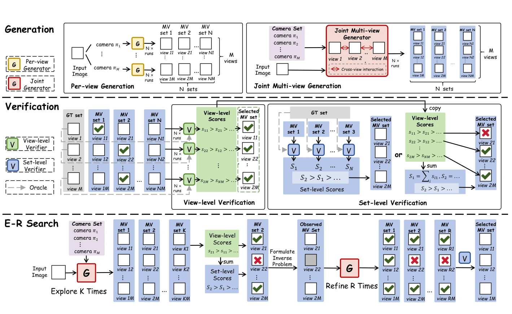
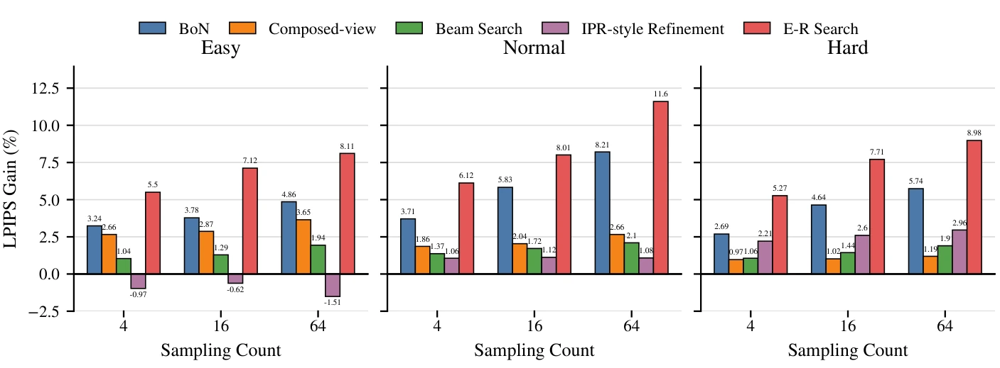
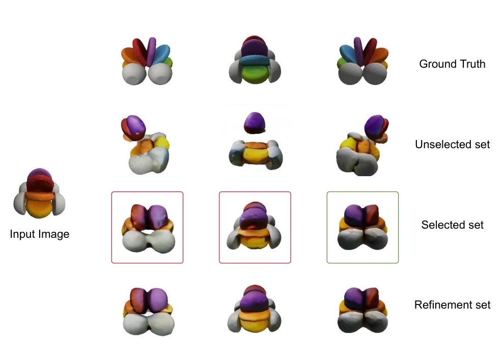

# Multi-View Diffusion under Test-Time Scaling

**Danlin Li¹ · Qing Zhang¹ · Jianmin Bao² · Zhen Wang¹ · Yutong Lu¹**

¹ Sun Yat-sen University  
² Kling Team, Kuaishou Technology

[**Paper (PDF)**](assets/paper.pdf)

## Overview

How should we allocate additional inference computation when generated views must remain consistent?

We systematically study **test-time scaling (TTS) for multi-view diffusion models** from three perspectives: **generation**, **verification**, and **search**. We introduce **DINO-centroid**, a lightweight, cross-sample consensus verifier, and **Exploration–Refinement Search (E-R Search)**, which preserves reliable views and conditionally regenerates uncertain views with a frozen multi-view diffusion model.

## Key findings

- **Generation:** Joint multi-view models show stronger Oracle scaling than the evaluated independent per-view models.
- **Verification:** Set-level selection preserves cross-view consistency, while view-level scoring identifies opportunities for improvement. DINO-centroid estimates candidate quality using feature consensus across generations.
- **Search:** E-R Search balances complete-set exploration and targeted view regeneration under matched inference budgets.

## Results

LPIPS improvement over single-sample generation on GSO with **N = 64** (higher is better):

| Method | Easy | Normal | Hard |
| :--- | ---: | ---: | ---: |
| Best-of-N | 4.86% | 8.21% | 5.74% |
| **E-R Search** | **8.11%** | **11.60%** | **8.98%** |

In downstream 3D reconstruction on the Normal subset, E-R Search achieves **0.0252 Chamfer Distance** (lower is better) and **0.568 Volume IoU** (higher is better).

## Qualitative example

The **first case study** from the paper is shown below. Green boxes indicate reliable views retained as observations, while red boxes indicate uncertain views targeted for refinement.

